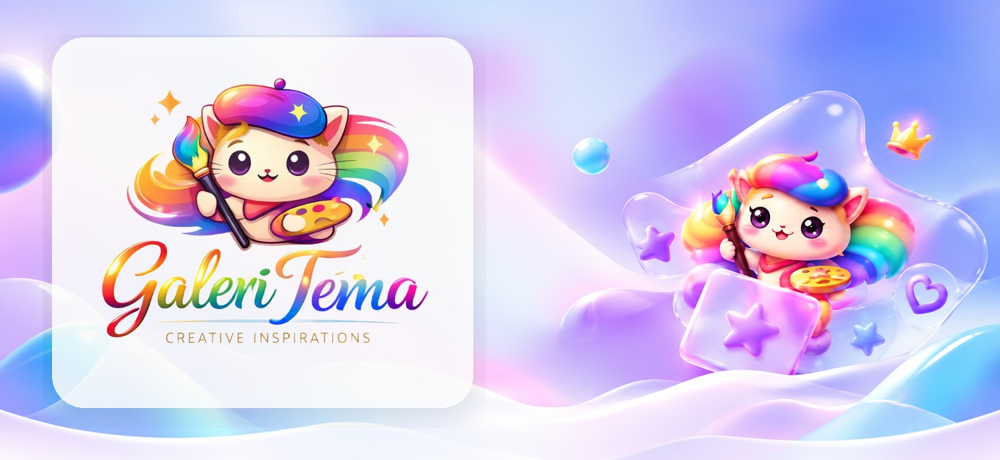

<!-- README Profil GitHub | Heading: Cabin Bold (vector); deskripsi visual: Inter (vector). Tidak memerlukan file font atau CSS. -->

  

  <h3>Membuat antarmuka yang terasa tepat, bukan sekadar terlihat menarik.</h3>
  
Berfokus pada desain UI, pengembangan frontend, dan pengalaman web yang rapi serta responsif.

 

<table>
  <tr>
    <td width="27%" align="center" valign="middle">
      
      
<strong>Zerith</strong> Frontend Developer

    </td>
    <td width="73%" valign="top">
      <h2></h2>
      
Halo, saya <strong>Zerith</strong>, seorang frontend developer yang menikmati proses mengubah ide menjadi antarmuka web yang bersih, responsif, dan nyaman digunakan.

      
Saya menaruh perhatian pada komposisi, keterbacaan, konsistensi komponen, serta detail kecil yang membuat pengalaman pengguna terasa lebih matang.

      
<strong>Fokus:</strong> Frontend Development · UI Design · Responsive Web · Reusable UI Components · Design Systems.

    </td>
  </tr>
</table>

  
  &nbsp;
  

 

---

 

<h2></h2>

  

 

**Galeri Tema** adalah koleksi desain untuk website top-up game, jual beli akun, dan landing page. Setiap tema memiliki karakter visual tersendiri, dengan perhatian pada tampilan yang rapi, navigasi yang jelas, dan pengalaman responsif.

Di dalamnya ada beberapa pendekatan desain seperti **Dark Morphic**, **Glass Morphism**, **Gamiz**, **Luna Girly**, **Nexus Putih**, dan **Nexus Hitam**.

  

 

---

 

<h2></h2>

**Fondasi web**

**Peralatan pengembangan**

 

---

 

<h2></h2>

**Desain yang terarah.** Setiap elemen punya fungsi dan posisi yang jelas, tanpa membuat halaman terasa sesak.

**Komponen yang konsisten.** Pola antarmuka dirancang agar dapat digunakan kembali dan lebih mudah dikelola.

**Penyempurnaan berkelanjutan.** Evaluasi detail, keterbacaan, serta tampilan desktop dan mobile menjadi bagian dari proses pengembangan.

 

---

 

<h2></h2>

  
  

 

---

 

  <h3>Desain yang baik menyatukan tampilan, kejelasan, dan kenyamanan.</h3>
  
Terima kasih sudah berkunjung.

  
<strong>Zerith</strong> · <a href="https://github.com/ZerithDev">GitHub</a> · <a href="https://themes.hanzstaging.my.id/">Galeri Tema</a>

  

