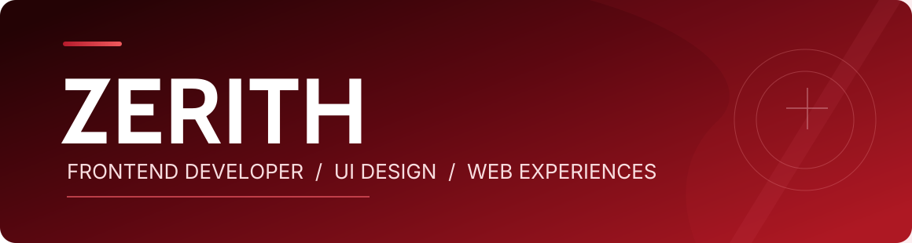
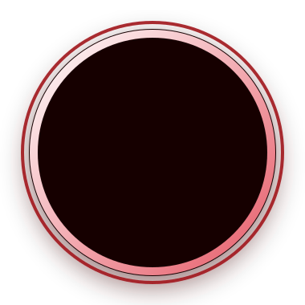
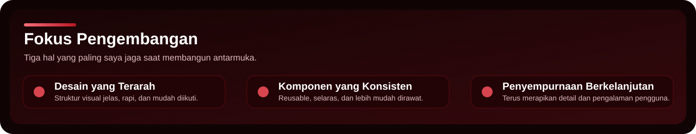

<!-- README Profil GitHub Zerith | Menggunakan SVG dan aset lokal agar tampilan lebih rapi di GitHub. -->

  

  <h3>Membuat antarmuka yang terasa tepat, bukan sekadar terlihat menarik.</h3>
  
Berfokus pada desain UI, frontend development, pengalaman web yang rapi, dan komponen yang konsisten.

 
 

<table>
  <tr>
    <td width="33%" align="center" valign="middle">
      
        
      <strong>Zerith</strong>
       
      Frontend Developer
    </td>
    <td width="67%" valign="top">
      <h2></h2>
      
Halo, saya <strong>Zerith</strong>, seorang frontend developer yang menikmati proses mengubah ide menjadi antarmuka web yang bersih, responsif, dan nyaman digunakan.

      
Saya menaruh perhatian pada komposisi, keterbacaan, konsistensi komponen, serta detail kecil yang membuat pengalaman pengguna terasa lebih matang.

      
<strong>Fokus utama:</strong> Frontend Development · UI Design · Responsive Web · Reusable UI Components · Design Systems.

      
<strong>GitHub username:</strong> <code>ZerithDev</code> <strong>Website:</strong> <a href="https://themes.hanzstaging.my.id/">themes.hanzstaging.my.id</a>

    </td>
  </tr>
</table>

  
  &nbsp;
  
  &nbsp;
  

 

  

 

---

 

<h2></h2>

  

 

<table>
  <tr>
    <td width="60%" valign="top">
      <strong>Galeri Tema</strong> adalah koleksi desain untuk website <strong>top-up game</strong>, <strong>jual beli akun</strong>, dan <strong>landing page</strong>.
        
      Proyek ini menampilkan berbagai eksplorasi visual yang menonjolkan karakter tema, komposisi layout, serta pendekatan UI yang berbeda-beda tetapi tetap rapi dan nyaman dipandang.
        
      Yang ingin saya tonjolkan dari proyek ini adalah bagaimana setiap tema memiliki identitas sendiri, namun tetap menjaga struktur yang jelas, navigasi yang mudah, dan pengalaman responsif di berbagai ukuran layar.
        
      
    </td>
    <td width="40%" valign="top">
      <strong>Eksplorasi tema</strong>
      <ul>
        <li>Dark Morphic</li>
        <li>Glass Morphism</li>
        <li>Gamiz</li>
        <li>Luna Girly</li>
        <li>Nexus Putih</li>
        <li>Nexus Hitam</li>
      </ul>
      <strong>Nilai yang dijaga</strong>
      <ul>
        <li>Visual yang menarik</li>
        <li>Komposisi yang bersih</li>
        <li>Detail UI yang rapi</li>
        <li>Tampilan yang tetap nyaman</li>
      </ul>
    </td>
  </tr>
</table>

 

---

 

<h2></h2>

<table>
  <tr>
    <td width="50%" valign="top">
      <strong>Fondasi web</strong>
        
      
        
      Digunakan untuk menyusun struktur halaman, membangun tampilan, dan menghadirkan interaksi yang nyaman.
    </td>
    <td width="50%" valign="top">
      <strong>Peralatan pengembangan</strong>
        
      
        
      Membantu alur kerja pengembangan, version control, pengelolaan proyek, dan eksplorasi kode.
    </td>
  </tr>
</table>

 

---

 

<h2></h2>

<table>
  <tr>
    <td width="33.33%" valign="top">
      <strong>Desain yang terarah</strong>
        
      Setiap elemen disusun agar punya fungsi yang jelas dan tidak membuat halaman terasa sesak.
    </td>
    <td width="33.33%" valign="top">
      <strong>Komponen yang konsisten</strong>
        
      Pola antarmuka dirancang agar dapat digunakan kembali dan lebih mudah dikelola saat proyek berkembang.
    </td>
    <td width="33.33%" valign="top">
      <strong>Penyempurnaan berkelanjutan</strong>
        
      Evaluasi detail, keterbacaan, serta tampilan desktop dan mobile menjadi bagian dari proses kerja saya.
    </td>
  </tr>
</table>

 

---

 

<h2></h2>

  
  

 

---

 

  <h3>Desain yang baik menyatukan tampilan, kejelasan, dan kenyamanan.</h3>
  
Terima kasih sudah berkunjung.

  
<strong>Zerith</strong> · <a href="https://github.com/ZerithDev">GitHub</a> · <a href="https://themes.hanzstaging.my.id/">Galeri Tema</a>

  

