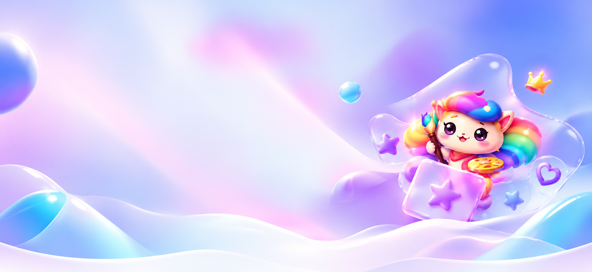
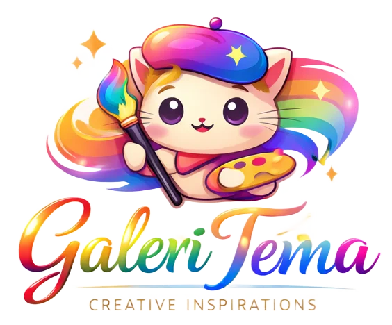

<!--
  README profil GitHub untuk Zerith
  Catatan:
  - Agar gambar Galeri Tema muncul di GitHub, simpan file berikut di repo:
    1) assets/galeri-tema-bg.webp
    2) assets/galeri-tema-logo.png
  - Sesuaikan nama file jika perlu, lalu ubah path pada README ini.
-->

  

  <h3>Membangun antarmuka yang rapi, nyaman, dan punya arah visual yang jelas.</h3>
  

    Saya berfokus pada frontend development, desain UI, responsive web,
    reusable components, dan design systems yang terasa matang saat digunakan.
  

 
 

<table>
  <tr>
    <td width="34%" align="center" valign="top">
      
        
      <strong>Zerith</strong>
       
      Frontend Developer
    </td>
    <td width="66%" valign="top">
      <h2>Tentang Saya</h2>
      

        Halo, saya <strong>Zerith</strong>. Saya senang membangun antarmuka web yang tidak hanya terlihat bagus,
        tetapi juga terasa jelas, terstruktur, dan nyaman dipakai.
      

      

        Fokus utama saya ada pada <strong>Frontend Development</strong>, <strong>UI Design</strong>,
        <strong>Responsive Web</strong>, <strong>Reusable UI Components</strong>, dan
        <strong>Design Systems</strong>.
      

      

        Saya menikmati proses menyusun hierarki visual, merapikan komponen, dan memperhalus detail
        agar tampilan akhir terasa lebih konsisten dan profesional.
      

      

        <strong>GitHub Username:</strong> <code>ZerithDev</code>
         
        <strong>Website:</strong> <a href="https://themes.hanzstaging.my.id/">themes.hanzstaging.my.id</a>
      

    </td>
  </tr>
</table>

 

  
  &nbsp;
  
  &nbsp;
  

 

---

 

## Fokus Pengembangan

<table>
  <tr>
    <td width="33.33%" valign="top">
      <strong>Desain yang Terarah</strong>
        
      Setiap elemen dibuat dengan tujuan yang jelas, ruang yang cukup, dan alur visual yang mudah diikuti.
    </td>
    <td width="33.33%" valign="top">
      <strong>Komponen yang Konsisten</strong>
        
      Saya membangun pola antarmuka yang rapi, bisa digunakan kembali, dan tetap selaras di banyak halaman.
    </td>
    <td width="33.33%" valign="top">
      <strong>Terus Disempurnakan</strong>
        
      Detail tampilan terus diperbaiki agar hasil akhirnya lebih matang, nyaman, dan mudah dipahami pengguna.
    </td>
  </tr>
</table>

 

---

 

## Sorotan Proyek Utama — Galeri Tema

  

 

  

 

<table>
  <tr>
    <td width="62%" valign="top">
      <h3>Galeri Tema</h3>
      

        <strong>Galeri Tema</strong> adalah koleksi tema modern untuk kebutuhan <strong>top-up game</strong>,
        <strong>jual beli akun</strong>, dan <strong>landing page</strong>.
      

      

        Proyek ini menampilkan berbagai eksplorasi visual yang menonjolkan karakter tema,
        komposisi layout, gaya antarmuka, dan kenyamanan tampilan di berbagai ukuran layar.
      

      
<strong>Yang membuat proyek ini menonjol:</strong>

      <ul>
        <li>Tampilan tema yang variatif dengan identitas visual yang berbeda-beda.</li>
        <li>Fokus pada UI yang bersih, menarik, dan mudah dinikmati.</li>
        <li>Struktur layout yang tetap nyaman untuk desktop maupun mobile.</li>
        <li>Pendekatan desain yang menyeimbangkan estetika dan fungsi.</li>
      </ul>
      

        
      

    </td>
    <td width="38%" valign="top">
      <h3>Eksplorasi Tema</h3>
      
<strong>Beberapa tema yang ditampilkan:</strong>

      <ul>
        <li>Dark Morphic</li>
        <li>Glass Morphism</li>
        <li>Gamiz</li>
        <li>Luna Girly</li>
        <li>Nexus Putih</li>
        <li>Nexus Hitam</li>
      </ul>
      

        Bagian ini saya jadikan showcase utama karena paling mencerminkan pendekatan visual,
        eksplorasi UI, dan karakter desain yang saya bangun.
      

    </td>
  </tr>
</table>

 

---

 

## Teknologi yang Digunakan

<table>
  <tr>
    <td width="50%" valign="top">
      <strong>Fondasi Web</strong>
        
      
        
      Digunakan untuk menyusun struktur, membangun tampilan, dan menghadirkan interaksi pada antarmuka.
    </td>
    <td width="50%" valign="top">
      <strong>Tools Pengembangan</strong>
        
      
        
      Mendukung workflow pengembangan, versioning, pengelolaan proyek, dan eksplorasi kode.
    </td>
  </tr>
</table>

 

---

 

## Ringkasan GitHub

  
  

 

  

 

---

 

## Prinsip Saya dalam Membangun Antarmuka

> Desain yang baik bukan hanya soal tampilan yang menarik,
> tetapi juga soal kejelasan, konsistensi, kenyamanan, dan bagaimana pengguna bisa memahami halaman dengan lebih mudah.

 

  <strong>Zerith</strong>
   
  Frontend Developer
    
  <a href="https://github.com/ZerithDev">GitHub</a>
  &nbsp;&middot;&nbsp;
  <a href="https://themes.hanzstaging.my.id/">Galeri Tema</a>
    
  

