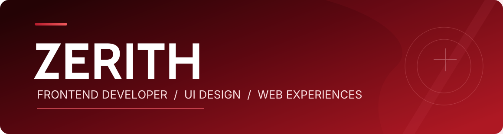
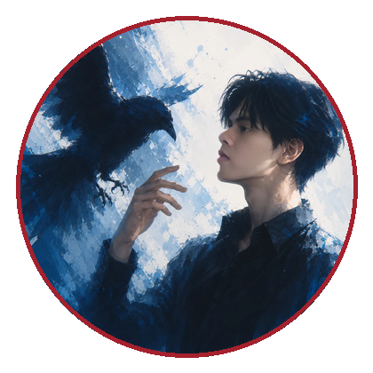
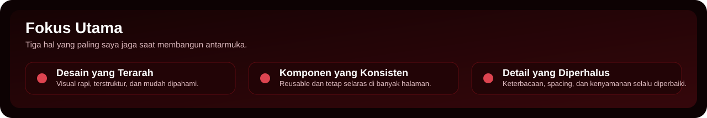
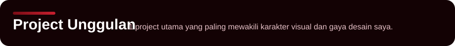
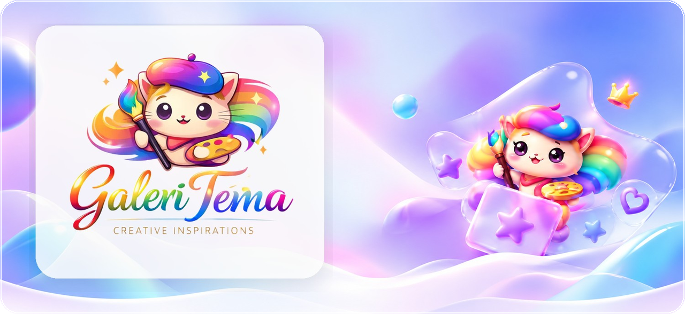

<!-- README Profil GitHub Zerith | Revisi final: hero user, avatar user, 1 project utama. -->

  

  <h3>Membangun antarmuka yang rapi, terarah, dan nyaman digunakan.</h3>
  
Berfokus pada frontend development, UI design, responsive web, dan komponen yang konsisten.

 
 

<table>
  <tr>
    <td width="32%" align="center" valign="middle">
      
        
      <strong>Zerith</strong>
       
      Frontend Developer
    </td>
    <td width="68%" valign="top">
      <h2>Tentang Saya</h2>
      
Halo, saya <strong>Zerith</strong>. Saya menikmati proses mengubah ide menjadi antarmuka web yang bersih, responsif, dan nyaman digunakan.

      
Saya menaruh perhatian pada komposisi, keterbacaan, konsistensi komponen, dan detail visual agar hasil akhirnya terasa lebih matang.

      
<strong>Fokus utama:</strong> Frontend Development · UI Design · Responsive Web · Reusable UI Components · Design Systems

      
<strong>GitHub username:</strong> <code>ZerithDev</code> <strong>Website:</strong> <a href="https://themes.hanzstaging.my.id/">themes.hanzstaging.my.id</a>

    </td>
  </tr>
</table>

  
  &nbsp;
  

 

  

 

---

 

  

 

  

 

<table>
  <tr>
    <td width="62%" valign="top">
      <h3>Galeri Tema</h3>
      
<strong>Galeri Tema</strong> adalah project utama yang saya tampilkan sebagai sorotan. Project ini berisi koleksi desain untuk website <strong>top-up game</strong>, <strong>jual beli akun</strong>, dan <strong>landing page</strong>.

      
Bagian ini paling mewakili cara saya mengeksplorasi visual, menyusun layout, dan membangun tampilan yang tetap rapi sekalipun gaya desainnya berbeda-beda.

      
Yang saya jaga dari project ini adalah identitas visual yang kuat, struktur halaman yang jelas, navigasi yang nyaman, dan pengalaman yang tetap enak dipakai di berbagai ukuran layar.

      

        
      

    </td>
    <td width="38%" valign="top">
      <h3>Yang Ditampilkan</h3>
      <ul>
        <li>Dark Morphic</li>
        <li>Glass Morphism</li>
        <li>Gamiz</li>
        <li>Luna Girly</li>
        <li>Nexus Putih</li>
        <li>Nexus Hitam</li>
      </ul>
      <h3>Nilai Utama</h3>
      <ul>
        <li>Visual yang menarik</li>
        <li>Komposisi yang bersih</li>
        <li>Detail UI yang rapi</li>
        <li>Tampilan yang tetap nyaman</li>
      </ul>
    </td>
  </tr>
</table>

 

---

 

## Teknologi yang Digunakan

<table>
  <tr>
    <td width="50%" valign="top">
      <strong>Fondasi web</strong>
        
      
        
      Digunakan untuk menyusun struktur halaman, membangun tampilan, dan menghadirkan interaksi yang nyaman.
    </td>
    <td width="50%" valign="top">
      <strong>Peralatan pengembangan</strong>
        
      
        
      Membantu workflow pengembangan, version control, pengelolaan project, dan eksplorasi kode.
    </td>
  </tr>
</table>

 

---

---

 

## Aktivitas GitHub

  Statistik singkat aktivitas dan bahasa yang paling sering saya gunakan di GitHub.

  
  

 

  

